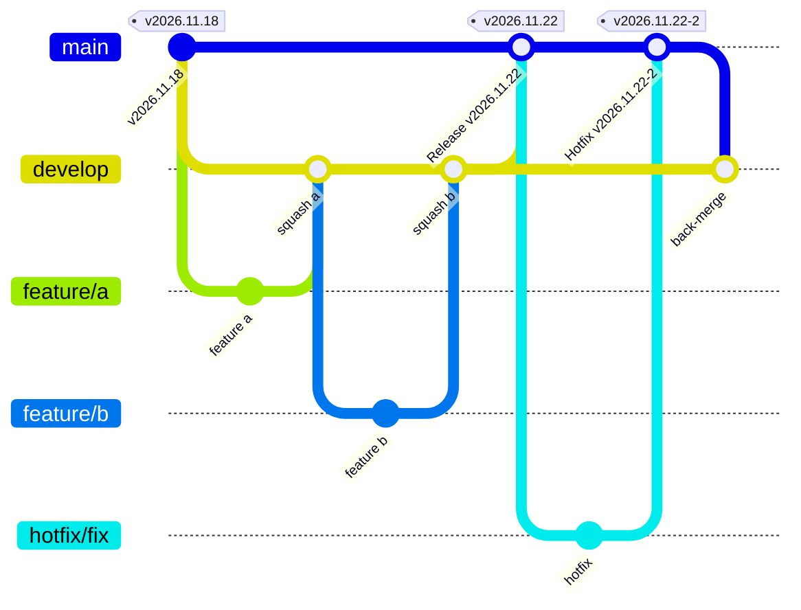
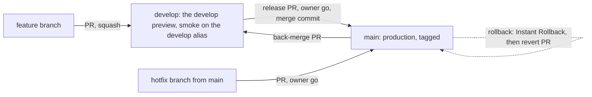

# Releases

How a change gets from a branch to production, in every product built from
this base. One scheme, so a release, a hotfix and a rollback work the same way
everywhere. The coordinator follows it with the `release` skill
(`.claude/skills/release/SKILL.md`); the mechanical parts are in
`scripts/release.mjs`.

## Branching strategy

| Branch | Is | Vercel | Who merges into it, and how |
| --- | --- | --- | --- |
| `main` | **Production.** Always what readers see; every release is a tag on it. | The project's **Production Branch**: a push builds Production. | Only a release pull request (`develop` into `main`) or a hotfix pull request, and only with the owner's `go` (or the owner merging it). Merge commit. |
| `develop` | **UAT**, and the repository's **default branch**. Feature pull requests target it. | A **Preview** at the branch alias `<project>-git-develop-<team>.vercel.app`; smoke checks that alias after each merge. | Agents: the coordinator merges a green feature pull request. Squash merge. |
| `feature/<slug>` (and agents' own branches) | One change, one pull request. | A per-pull-request **Preview** at the branch alias. | The branch's own pull request into `develop`; the branch is deleted on merge. |
| `hotfix/<slug>` | An urgent fix for a defect live on production. Branched from `main`. | A Preview, like any branch. | A pull request into `main` (owner `go`, as for a release), then `main` is merged back into `develop` by a pull request the same day. |

What deploys where: a merge to `develop` builds the `develop` preview and nothing else; production changes only when a release or hotfix pull request is merged into `main`. The two are separate Vercel builds of separate branches, so a feature on the `develop` preview cannot reach readers by itself.

Who may merge where: agents merge into `develop` once `verify` is green. Nothing merges to `main` without the owner's `go`, a comment by the owner's login on the release or hotfix pull request, or the owner merging it themselves. A `go` from anyone else is ignored.

The owner's `go` is discipline, with one mechanical bound. Nothing blocks a push to `main` (branch protection is not available here; see `docs/sops.md` SOP 1). A `go` counts only when the owner's login posted `go <sha>`, naming the pull request's current head in full (all 40 characters; a short prefix or a bare `go` does not count, since a short prefix can be ground), so it is bound to the commit and not to a date a pushed commit can fake, and the coordinator merges with that head's `sha`, so GitHub refuses the merge if the head moved after `go`. What the owner approved is therefore the head that merges; anything beyond that rests on the coordinator following this page.

Version: a CalVer tag `vYYYY.MM.DD` on `main`, with `-2`, `-3` for further releases the same day. There is no version file. The GitHub Release carries the same notes as the pull request.

Preview resources: a product that stores data gives previews (the `develop`
preview included) their own database and storage rather than production's, by a
separate set of variables for the Preview environment. The `PREVIEW_*` pattern
in product-photojournalism-site is the worked example. This is guidance for
each product, not engine code.

## Release

1. **Cut.** The coordinator runs `node scripts/release.mjs plan`: the next tag
   (`vYYYY.MM.DD`, suffixed for a second release that day) and notes listing
   every pull request behind a commit `develop` has and `main` lacks, with
   links (so one merged while a release pull request is open waits for the
   next release). It opens a pull request `develop` into `main` titled
   `Release vYYYY.MM.DD`, notes as the body. If `main` lacks nothing from
   `develop`, there is nothing to release and no pull request. A release
   pull request gets no `pr checks` run: `pr-checks.yml` runs only on pull
   requests into `develop` (#373), where every change in the release already
   had its contention and census checks. `verify` still runs on it.
2. **Wait for the owner.** `node scripts/release.mjs go --pr <n>` exits 0 only
   when the owner commented `go <sha>` (author login checked; `<sha>` is the full
   40-character current head, so a later push voids it) or merged the pull request; it prints the head `sha`. Otherwise the pull request stays open and the run reports it as
   waiting for the owner.
3. **Merge** with a merge commit, passing the printed `sha` (never squash: `main` keeps `develop`'s
   history, so the back-merge is empty).
4. **Tag and release.** `node scripts/release.mjs tag --pr <n>` tags the
   merge commit and creates the GitHub Release through the REST API, with the
   pull request body as notes.
5. **Confirm production.** The push to `main` starts smoke, which checks the
   production URLs (a freshness gate on that commit, then the app's checks).
   The release is done when it is green.

## Hotfix

A defect is live and cannot wait for the next release.

1. Branch `hotfix/<slug>` from `main`; fix with a test, as for any change.
2. Pull request into `main`. The owner's `go` is required, as for a release.
   Merge with a merge commit, tag as a release (`node scripts/release.mjs tag`),
   and confirm production smoke.
3. The same day, open a pull request merging `main` into `develop` (the
   back-merge) so the fix is not lost at the next release, and merge it with a
   merge commit, never a squash, so `main` becomes reachable from `develop`.

## Rollback

A release turns out bad. Two steps, in this order:

1. **Vercel Instant Rollback** to the previous production deployment (Project,
   Deployments, the previous Production build, Instant Rollback). This is
   immediate and changes no git state. The previous production build is still
   there because the preview prune keeps production history.
2. **A revert pull request on `main`** (`git revert -m 1 <release merge commit>`
   on a branch from `main`), with the owner's `go`, so the next production
   build matches what is live. Back-merge it into `develop`. Until it merges,
   do not push to `main`: a new production build would replace the rollback.

## A product already on `develop` as production

Older products publish production from `develop` (`productionBranch` absent).
To move one:

1. Create `main` at the current `develop` commit (`gh api
   repos/<owner>/<repo>/git/refs -f ref=refs/heads/main -f sha=<develop sha>`).
2. In each Vercel project, set **Production Branch** to `main`. Production
   keeps serving the build it has until `main` next changes.
3. Set `"productionBranch": "main"` in `project.json` by a pull request.
   Smoke then checks production on a push to `main`, and the `develop` alias
   on a push to `develop`.
4. Tag the first release by cutting one as above.

A new product made by `setup create` starts this way: `main` and `develop`
exist, `develop` is the default branch, and `project.json` says
`productionBranch: "main"`. `deploy:add`'s owner steps include setting
Production Branch to `main` on each Vercel project.
