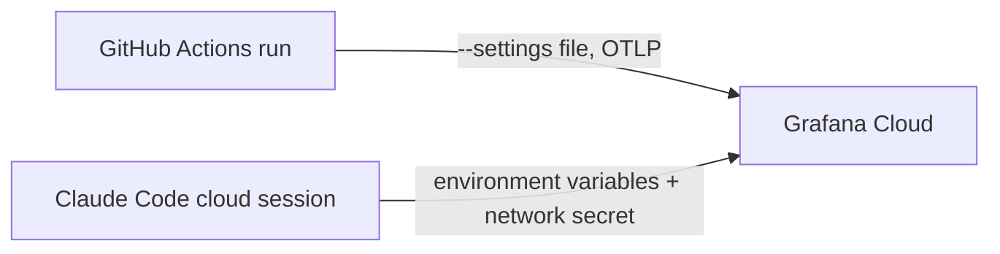

# Telemetry

Closes the `aia1` gap recorded in the issue tracker: *nothing
measures token use, active time, or output per merged change.*

Claude Code emits OpenTelemetry metrics and events. They go to **Grafana Cloud
only**. There is no local collector, Prometheus or Grafana: the owner decided
(2026-11-08) that nothing is stored on a laptop.



## The number this exists to produce

**Tokens per merged pull request.** Token spend on its own says nothing: it
falls when you do less and rises when you do more. Divided by merged changes it
becomes a rate, and a rate can be compared week to week.
`claude_code.active_time.total` is the second axis: it separates *this took a
lot of tokens* from *this took a lot of me*.

## What is switched on, and what is not

[`../.claude/settings.json`](../.claude/settings.json) carries the exporter
switches (enable flag, `otlp` exporters, intervals, include flags, cumulative
temporality), so the setting is visible to everyone working here. It also
carries the **endpoint and protocol**, because cloud sessions do not receive
the environment's `OTEL_EXPORTER_OTLP_*` variables (observed 2026-11-08). A
settings file beats the process environment ("Claude Code writes each `env`
entry into the process environment, replacing the value inherited from the
shell", <https://code.claude.com/docs/en/env-vars>), so an environment that
sets a different endpoint is overridden by this one. It carries **no
headers**: auth is the network secret. A test
(`scripts/test/write-ci-telemetry-settings.test.ts`) pins both.

**Events on, content off.** `OTEL_LOGS_EXPORTER=otlp` is set, because Grafana
Cloud's Claude Code integration reads events as well as metrics. Three
variables turn events into the prompts and file contents themselves:

```
OTEL_LOG_USER_PROMPTS      # your prompts
OTEL_LOG_TOOL_DETAILS      # tool inputs
OTEL_LOG_TOOL_CONTENT      # file contents read and written
```

**None of them is set anywhere in this repository, and none should be.** Unset
is off. They are deliberately absent rather than set to `0`, because `"0"` is a
truthy string in more places than it ought to be and absence cannot be
misread.

`OTEL_EXPORTER_OTLP_METRICS_TEMPORALITY_PREFERENCE=cumulative` is required by
the integration. Claude Code can emit *delta* temporality, and a
Prometheus-backed store such as Grafana Cloud's drops delta sums with no error
anywhere: the panels read "No data", which looks like a wrong metric name.

## Cloud sessions

A Claude Code cloud session reports to Grafana Cloud directly:

- `OTEL_EXPORTER_OTLP_ENDPOINT` — the Grafana Cloud OTLP gateway, ending
  `/otlp`, and `OTEL_EXPORTER_OTLP_PROTOCOL=http/protobuf`, both committed in
  `.claude/settings.json` (see above).
- a **network secret** on the cloud environment for the gateway host, which the
  network proxy injects as the `Authorization` header, so no credential sits in
  the repository, the settings file or the session's environment.

A session started above the repository (several repositories attached) loads
no repository settings and sends nothing; see the next section.

### Sessions with several repositories

Such a session's working directory is above the checkouts, so no repository's
`.claude/settings.json` is read, but `~/.claude/settings.json` always is. The
environment's setup script (it runs as root after the repositories are cloned,
before Claude starts) runs `scripts/user-telemetry-settings.mjs`, which merges
the telemetry keys (`CLAUDE_CODE_ENABLE_TELEMETRY` and `OTEL_*`, never a
`*_HEADERS` key) of the repository's committed settings into the user file. It
keeps every other key already there, creates the file if absent, is idempotent,
and on invalid JSON (or an endpoint containing `@`) exits non-zero without
writing; a repository with no telemetry keys is a notice on stderr and exit 0, so
the line cannot fail a session start. Only an explicit key list is copied, not
the `OTEL_*` prefix, so the content-bearing `OTEL_LOG_*` switches never travel. Add this line to the
environment's setup script, with `<repo>` the checkout's directory name (this
file ships to every repository built from the base, so it names none; the
filled-in line is in the "Cloud setup script" block of each README.md):

```bash
if [ -d <repo> ]; then node <repo>/scripts/user-telemetry-settings.mjs --repo <repo>; fi
```

The setup script runs as root, so this writes root's `~/.claude/settings.json`.
That is the user Claude runs as in a cloud session: in this container `id -u` is
0 and `$HOME` is `/root`, and the session itself runs here. Unverified: that a
fresh session's Claude process reads that file (the Grafana check in #299 item 2
is the confirmation).

## The unattended runs (CI)

Claude also runs in GitHub Actions: `claude-code-review.yml` on every pull
request, and `claude.yml` whenever someone tags `@claude`. That is the spend
least likely to be noticed, because nobody is sitting there while it happens.

`claude-code-action` passes nine `OTEL_*` variables through from `env`; if a
workflow does not set them, CI telemetry is off, not failing quietly.

The settings are not exported as environment variables, because **a settings
file beats the process environment** and `.claude/settings.json` is checked out
on the runner. `scripts/write-ci-telemetry-settings.mjs` therefore writes a
settings file to `$RUNNER_TEMP`, and the session loads it with `--settings` in
`claude_args`. That flag outranks even a project-local file
(<https://code.claude.com/docs/en/settings>), and it sidesteps a second limit:
the action forwards exactly nine `OTEL_*` variables, and
`OTEL_EXPORTER_OTLP_METRICS_TEMPORALITY_PREFERENCE` is not among them.

Writing to `.claude/settings.local.json` instead looks tempting and fails:
`claude-code-action` checks out a pull request's head, treats it as untrusted,
and deletes and restores `.claude` from the base branch immediately before the
CLI starts. The file is gone before Claude Code reads it, and CI runs without
its endpoint or `environment` label. Writing outside the checkout keeps it
where that restore never looks.

CI sessions are told apart from others by `OTEL_RESOURCE_ATTRIBUTES`:

| Attribute | CI |
| --- | --- |
| `environment` | `ci` |
| `repository` | `owner/name` from `GITHUB_REPOSITORY`, or `unknown`; splits usage per repo on a shared stack |
| `workflow` | `claude-code-review`, `claude-security-review` or `claude-mention` |
| `run_id`, `run_attempt` | the GitHub run |

Without that split, tokens per merged PR quietly absorbs the review bot.

Two deliberate choices in the script:

- **Gated on the credential.** `CLAUDE_CODE_ENABLE_TELEMETRY` is `1` only when
  both secrets are set, and the file is written *either way*: the committed
  settings enable telemetry and name the Grafana gateway, so with no block at
  all the run would send unauthenticated exports there for the whole job.
- **5s export interval, not 10.** A runner is destroyed the moment the job
  ends, and a flush on exit is not documented.

### Switching it on

Grafana Cloud ships a **Claude Code integration** (Connections, the Claude Code
tile, Install) that provisions one dashboard, "Claude Code".

1. Grafana Cloud Portal, your stack, the **OpenTelemetry** tile, Configure.
   Generate a token; it prints the `OTEL_*` variables ready-made.
2. Install the **Claude Code** integration from Connections.
3. Set two repository secrets for CI:
   - `GRAFANA_CLOUD_OTLP_ENDPOINT` — the endpoint, ending `/otlp`
   - `GRAFANA_CLOUD_OTLP_AUTH` — the whole `OTEL_EXPORTER_OTLP_HEADERS` value,
     `Authorization=Basic <base64>`
4. Set the endpoint and protocol variables, and the network secret, on the
   Claude Code cloud environment (above).

Until step 3, both workflows run with telemetry off.

### Checking it actually arrives

Every telemetry failure here is silent by construction: a failed OTLP export
writes nothing to the Actions log. Wrong temporality, an overriding endpoint and
a deleted `.claude` have all hidden behind that, and each is found the same way:
**read the store's own attributes, never the config.**

Grafana Cloud, Explore, the `grafanacloud-…-prom` datasource, a 7-day window:

```promql
count by (environment, terminal_type) ({__name__=~"claude_code.*"})
```

| Result | Reading |
| --- | --- |
| A series with `environment="ci"` | CI telemetry is arriving. |
| Series with no `environment` | Cloud or other sessions only. CI is silent: check the secrets and the `--settings` step. |
| Nothing at all | Nothing is reaching the store. Check the cloud environment's variables and network secret. |

To pin it to one CI run:

```promql
claude_code_token_usage_tokens_total{environment="ci", run_id="<the run>"}
```

`claude_code_pull_request_count` has no series for a review run. Claude Code
emits it only when a session itself opens a pull request, and a reviewer does
not. That "No data" is expected.

<https://code.claude.com/docs/en/monitoring-usage>
